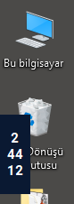
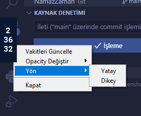

# 🕌 NamazZamanı

**NamazZaman** - Windows 10 için hafif, kullanışlı ve minimalist bir namaz vakti geri sayım widget'ı. 🌙 Namaz vakitlerini **Diyanet İşleri Başkanlığı**'ndan otomatik olarak alır ve bir sonraki namaza kadar kalan süreyi anlık olarak gösterir. Çalışma veya öğrenme sırasında hızlı bir göz atma aracı olarak tasarlandı. 
Artık vakit kaçırmak yok! 🚀






## ✨ Özellikler 
- 🕋 **Namaz vakitleri:** Diyanet İşleri Başkanlığı’nın resmi sitesinden 30 günlük vakitler indirilir.
- ⏳ **Geri sayım özelliği:** Bir sonraki namaz vaktine kadar kalan süreyi 00:00:Sn cinsinden gösterir.
- 🎯 **Minimalist widget:** Yatay veya dikey modda çalışır. Sadece 88x34px boyutunda!
- 📌 **Her Zaman Üstte:** Diğer pencerelerin üzerinde kalır, hızlı erişim sağlar.
- 💨 **Kenara yapışma:** Pencereyi sürükleyip kenarlara yapıştırarak düzenli kullanım.
- 🖱 **Sağ tıklama menüsü:** Opaklık, yön ve manuel güncelleme gibi hızlı ayarlar.
    - ↻ **Yön seçimi:** Yatay veya dikey görünüm tercihi.
    - 🕶 **Opacity (opaklık) kontrolü:** %50, %75 ve %100 seçenekleri.
    - 🔄 **Vakitleri güncelle:** İstediğiniz zaman namaz vakitlerini indirebilirsiniz.

---

## ⚙️ Kurulum

### Gereksinimler

- **Python 3.6+**
- Gerekli Python Kütüphaneleri:
  - `tkinter`
  - `requests`
  - `beautifulsoup4`

### Adımlar

1. **Depoyu Klonlayın:**

  ```bash
  git clone https://github.com/kullanici-adi/namaz-zaman.git
  cd namaz-zaman
  ```

2. **Gerekli Kütüphaneleri Yükleyin:**

  `pip install -r requirements.txt`

  Alternatif olarak, aşağıdaki komutu kullanabilirsiniz:

  `pip install requests beautifulsoup4`

3. **Uygulamayı Çalıştırın:**

  `python namaz_zaman.py`

## 🎮 Kullanım

- **Taşıma:** Widget'a tıklayıp sürükleyerek ekran üzerinde istediğiniz konuma taşıyabilirsiniz.
- **Sağ Tıklama Menüsü:**
  - **Vakitleri Güncelle:** Namaz vakitlerini manuel olarak günceller.
  - **Opacity Değiştir:** Widget'ın opaklığını %50, %75 veya %100 olarak ayarlayabilirsiniz.
  - **Yön:** Zaman görüntüleme biçimini yatay veya dikey olarak değiştirebilirsiniz.
  - ❌ **Kapat:** Widget'ı kapatır.
- **Kapatma:** `Escape` tuşuna basarak widget'ı kapatabilirsiniz.

## Lisans

Bu proje [MIT Lisansı](https://opensource.org/licenses/MIT) ile lisanslanmıştır. Herkesin kullanımına açıktır ve katkıda bulunmanızı bekleriz! 🎉
Copyright (c) 2024 Ali Tekdemir

## 💬 İletişim

Proje ile ilgili sorularınız veya önerileriniz için e-mail adresimden bana ulaşabilirsiniz.

## 🌟 Teşekkürler

Diyanet İşleri Başkanlığı: Namaz vakitlerini sağladıkları için teşekkür ederiz.
Python ve Tkinter: Bu projeyi mümkün kılan güçlü araçlar.

---

**Katkı ve Destek:** Projeye kod, hata bildirimi veya [GitHub Sponsors](https://github.com/sponsors/alitekdemir) üzerinden katkıda bulunabilirsiniz.
